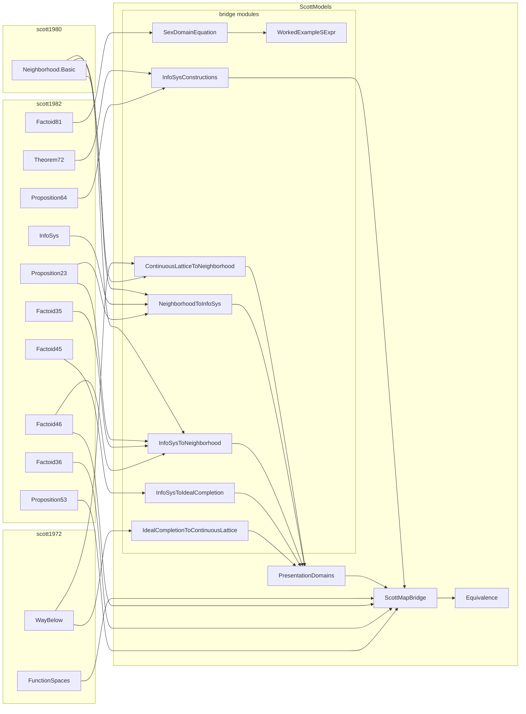

# Catalog of bridge theorems

| Theorem | Direction | Lean module | Scope |
| --- | --- | --- | --- |
| `continuousLattice_to_neighborhoodSystem` | 1972 → 1980 | `ContinuousLatticeToNeighborhood.lean` | library |
| `neighborhoodSystem_to_infoSys` | 1980 → 1982 | `NeighborhoodToInfoSys.lean` | compared |
| `infoSys_to_neighborhoodSystem` | 1982 → 1980 | `InfoSysToNeighborhood.lean` | compared |
| `infoSys_to_idealCompletion` | 1982 → algebraic | `InfoSysToIdealCompletion.lean` | library |
| `idealCompletion_to_continuousLattice` | algebraic → 1972 | `IdealCompletionToContinuousLattice.lean` | library |
| `presentation_domains_equiv` | three-way | `PresentationDomains.lean` | compared |
| `infoSys_constructions_equiv` | constructions | `InfoSysConstructions.lean`, `ScottMapBridge.lean` | library |
| `sexNeighborhoodIso` / `sexIdealIso` / `sexDomainEquationIso` | S-expression instance | `WorkedExampleSExpr.lean`, `SexDomainEquation.lean` | compared |

The sibling packages are **finished dependencies**, not work items of this paper:
[`scott1972`](https://github.com/catskillsresearch/scott1972),
[`scott1980`](https://github.com/catskillsresearch/scott1980), and
[`scott1982`](https://github.com/catskillsresearch/scott1982) (information systems through
Factoid 8.4 / domain equations). They are vendored in `vendor/` at frozen SHAs
(see `vendor/FROZEN.txt` / `lakefile.toml`), with the local modifications
recorded there and in `formalization.yaml`; the remotes remain the per-paper homes.
The compared family (Palomar `Challenge.lean` / `comparator.json`) is the 1980 ↔ 1982
coding, the round three-way identification, and the Factoid 8.1 instance; the other
catalog rows are proved in `ScottModels/` but are not Comparator targets. This
package was verified and registered in the Palomar registry as
[PALOMAR-2026-08-25-000003](https://palomar-registry.org/entry?id=PALOMAR-2026-08-25-000003&version=1)
v1 **[PALOMAR26]**. What Palomar verified is the claim:

> Order isomorphisms relating Scott’s three presentations of domains — continuous
> lattices (1972), neighbourhood systems (PRG-19), and information systems (1982) —
> including the round identification `D ≃o RoundFilter ≃o RoundInfoSysElement` and
> the S-expression equation `T ≅ A + (T × T)` as `|T| ≃o |A + (T × T)|`
> (`SexSys.Element ≃o SexRhs.Element`).

This document (`view.pdf`) is the narrative account, not a formalization of the three
papers. The module map below is left-to-right: sibling packages on the left, local
`ScottModels/` modules on the right, with arrows for **direct** imports (transitive
imports inside the siblings are omitted). `Equivalence` re-exports the bridges; only
the `ScottMapBridge → Equivalence` edge is drawn to avoid clutter. Root
`ScottModels.lean` also opens 1972 `ContinuousLattice.Specialization`, 1980
`Neighborhood.Basic`, and 1982 `InfoSys`.

<!-- mermaid-caption: Lean module map -->

