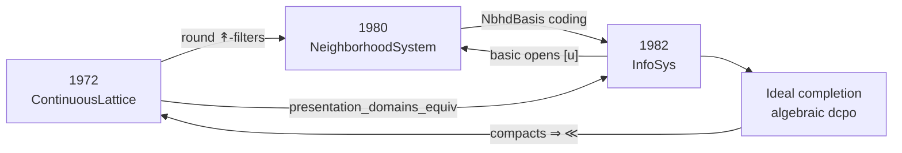

# Introduction

Neighbourhood systems and information systems
are equivalent in a precise sense. The mathematical folklore is stronger still: all
three presentations carve out the same class of domains, related by ideal completion
and the Scott topology. That equivalence is already known; this article is the write-up of a
machine-checked proof of the named bridges, not a first presentation of the
result. The three presentations were formalized in separate libraries; the maps
between them are the content of this package.

We do **not** re-prove Scott's internal theorems; we import the finished sibling
packages and build cross-presentation maps:

| Presentation | Lean package | Characteristic object |
| --- | --- | --- |
| Continuous lattices **[Sco72]** | `scott1972` | `ContinuousLattice D`, way-below `≪`, `ScottMap` |
| Neighbourhood systems **[Sco81]** | `scott1980` | `NeighborhoodSystem`, filters as domain elements |
| Information systems **[Sco82]** | `scott1982` | `InfoSys`, elements as consistent closed token sets |

The main subtlety is that a naïve reading of “domains = filters of neighbourhoods”
overstates the continuous-lattice corner: for a continuous lattice `D`, the filter
`{↟a | a ≤ x}` has retract `x` but properly contains the principal round filter
`{↟a | a ≪ x}`. The correct identification is **`D ≃o RoundFilter`**, not raw `|𝒟|`.

We prove **order isomorphisms of domains** (and of the named construction objects), not
a 2-categorical equivalence of the full categories of continuous lattices /
neighbourhood systems / information systems with all morphisms. Morphisms are linked
where the sibling packages already supply them:

- approximable maps ↔ Scott-continuous maps on `|A|` (Factoid 4.6);
- Scott maps of continuous lattices ↔ their conjugates on the round presentation.

A full functorial equivalence (preserving products, exponentials, and inverse limits
simultaneously across all three presentations) would require additional coherence
theorems.
