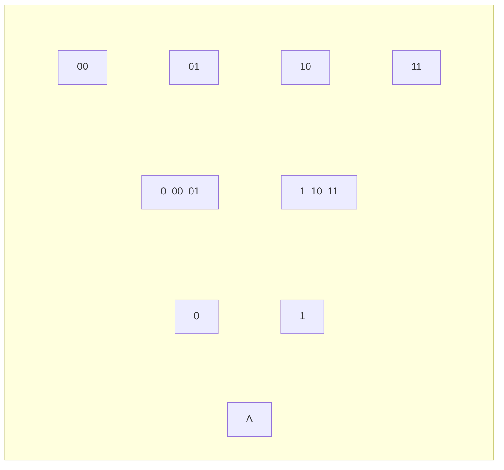

# Example 1.4

EXAMPLE 1.4. Let $\Delta = \{\Lambda, 0, 1, 00, 01, 10, 11\}$ and let $\mathcal{D} = \{\Delta, \{0, 00, 01\}, \{1, 10, 11\}, \{00\}, \{01\}, \{10\}, \{11\}\}$.

Or more understandably in pictures:

The tokens are finite sequences of 0's and 1's (up to length 2) with $\Lambda$ the empty sequence; they form — in the picture — the binary tree with the sequences as the nodes. The neighbourhoods are the subtrees of all nodes above a given node. Obviously this can be generalized to sequences of any length (and to trees less regular than the binary tree). The total elements of the example correspond to the top nodes 00, 01, 10, 11 and the lower nodes to the partial elements. When we are not at a top node we have only partially determined a sequence, and the branching indicates that we have some choice as to how the sequence can be extended. $\square$

It should be noted that, in these three examples, the reason that we have a neighbourhood system is a simple consequence of a

**Resolutions from the image:** “is unique” (not “in unique”); $\mathcal{D}$ begins with $\Delta$, not $\Lambda$; Pass 1’s nested-box diagram matches the neighborhood boundaries in the scan; em dashes around “in the picture” as in the source.

**[NeighbourhoodSystems/DomainsGivenByNeighbourhoods/Example_1_4.lean](Example_1_4.lean)**

@import "Example_1_4.lean"
